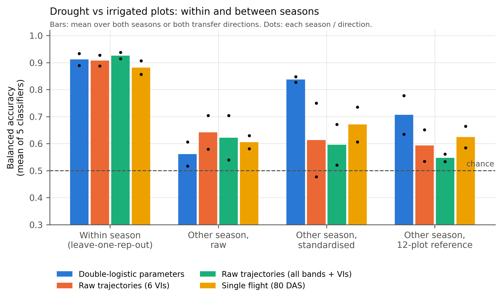
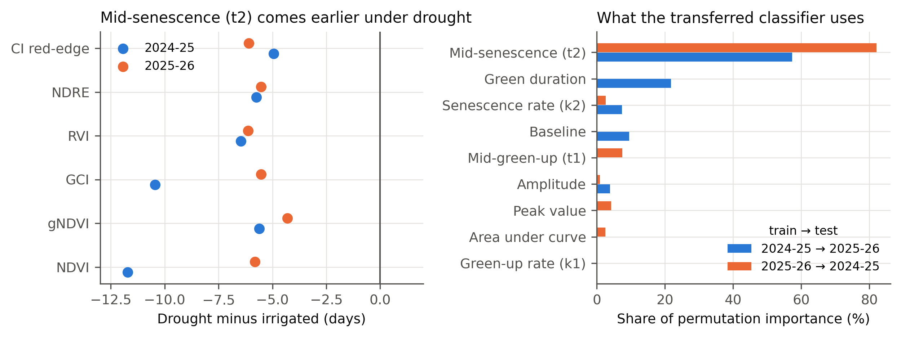
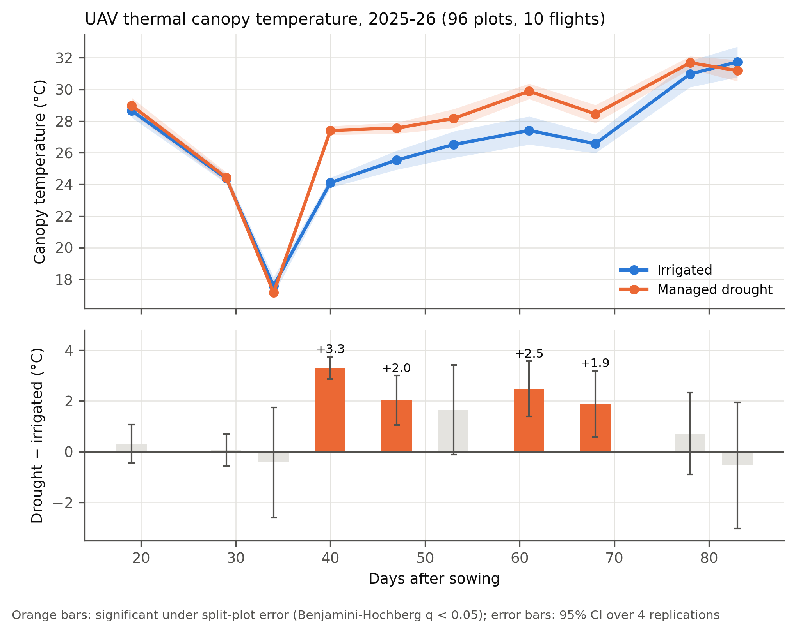
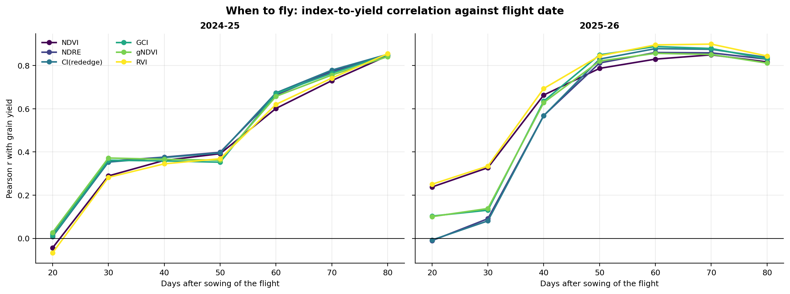

# UAV phenology and drought-stress phenotyping in wheat

Code for a two-season UAV study of wheat under managed drought. It turns multispectral and thermal time series into yield predictions and drought-stress phenotypes, and validates them **across seasons**, not only within one.

**Author:** Md. Khalid Hasan Milu ([ORCID 0009-0008-5927-5814](https://orcid.org/0009-0008-5927-5814)). GIS and Remote Sensing Lab, Department of Agroforestry and Environment, Gazipur Agricultural University, Bangladesh. MS thesis supervised by Prof. Dr. Hasan M. Abdullah, co-supervised by Dr. Md. Farhadur Rahman.

> **Data:** the field data are unpublished and are **not** in this repository. Everything runs on a **synthetic demo dataset** with the same structure ([data/README.md](data/README.md)).

---

## The experiment
- Gazipur Agricultural University, Bangladesh; wheat (BWMRI Gom-1); rabi seasons **2024–25** and **2025–26**.
- **Split-plot design:** irrigated vs managed drought (main plots) × 4 nitrogen rates × 3 seaweed-extract doses, 4 replications, **96 plots per season**.
- **UAV:** MicaSense Altum on **11 and 10 dates** (multispectral both seasons, thermal in 2025–26); 38 vegetation indices; double-logistic curves describing green-up, peak and senescence.
- **Ground truth measured by hand:** stomatal conductance, ΦPSII, ETR, leaf temperature, chlorophyll, MDA, H₂O₂, biomass and yield components.

## Two analyses

| Folder | Question | Language |
|---|---|---|
| [`curve_fitting/`](curve_fitting/) | Fit the double-logistic curve to every index of every plot, per season | R |
| [`yield_crossseason/`](yield_crossseason/) | Do UAV phenology models predict grain yield, and does that hold in a new season? 12 algorithms, nested cross-validation, 5 validation schemes (6,444 configurations). | Python + independent R re-implementation |
| [`stress_thermal/`](stress_thermal/) | Can canopy trajectories identify drought-stressed plots in a new season? What does UAV thermal add? | Python |

## Main findings

**Yield** ([details](yield_crossseason/README.md)):
- Raw UAV index trajectories predicted grain yield better than fitted double-logistic parameters or destructive sampling (R² 0.82 / 0.81 vs 0.71 / 0.79 vs 0.72).
- One flight at 70–80 days after sowing gave r ≈ 0.85 with yield in both seasons.
- Models failed when moved raw to the other season (R² < 0), but recovered to 0.58–0.76 after within-season standardisation. **The structure transfers; the calibration does not.**
- Selecting predictors by AIC and scoring on the same data overstated R² by 0.155 on average.

**Stress** ([details](stress_thermal/RESULTS.md)):
- Classifying drought vs irrigated plots in the *other* season, the **double-logistic parameters reached 0.84 balanced accuracy** after within-season standardisation, against 0.61 for raw trajectories. This is the mean of five classifiers.
- The transferable signal is **senescence timing:** drought advanced mid-senescence by 4–12 days in every index, both seasons and every replication.
- **UAV thermal:** drought plots were 1.6–3.3 °C warmer from 40 to 68 days after sowing, matching 35% lower stomatal conductance measured by hand. A thermal stress index correlated with grain yield at r = −0.69.

| | |
|---|---|
|  |  |
|  |  |

More figures are in [`figures/`](figures/).

## Quick start (synthetic demo data)

```bash
git clone https://github.com/milukhalidhasan/uav-wheat-drought-phenology.git
cd uav-wheat-drought-phenology

# stress analyses: reads data/demo automatically (about 6 min)
pip install -r stress_thermal/code/requirements.txt
python stress_thermal/code/run_all.py

# yield analyses on the demo tables (skips the dataset build, which needs the raw workbooks)
pip install -r yield_crossseason/python/requirements.txt
mkdir -p yield_crossseason/03_CSV && cp data/demo/*.csv yield_crossseason/03_CSV/
python yield_crossseason/python/univariate_analysis.py
python yield_crossseason/python/stepwise_vs_cv.py
```

Results computed on the demo data are **meaningless**. The demo only shows that the code runs.

## Running on the real data
See [data/README.md](data/README.md). In short:
1. Point the build step at the two source workbooks (`WHEAT_S1_XLSX`, `WHEAT_S2_XLSX`) and run `yield_crossseason/python/run_all.py`.
2. Copy the resulting tables to `data/full/` (git-ignored) for the stress analyses.

## Repository layout
```
├── curve_fitting/       per-season double-logistic fitting (R, nlsLM)
├── yield_crossseason/   yield pipeline: python/ (canonical) and R/ (independent check)
├── stress_thermal/      drought classifier, thermal analysis, RESULTS.md
├── data/                README, Data_Dictionary.csv, demo/ (synthetic); full/ is git-ignored
└── figures/             selected figures from both analyses
```

## How this code was written
The code was written with AI assistance (Claude, Anthropic). The field and laboratory data were collected by the author. The main tables are reproduced independently in Python and R.

## Citation
Milu, M.K.H., et al. *UAV-Based Impact Assessment of Seaweed Extract (Gracilaria spp.) and Nitrogen Fertilizer on Wheat Growth and Yield under Drought Stress Using Machine Learning and Double Logistic Model.* Manuscript in preparation. Please cite this repository until the paper is published.

## License
Code: MIT (see [LICENSE](LICENSE)). The figures and the (withheld) field data are not covered by the code license.
